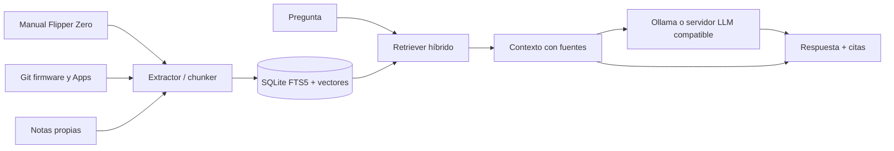

# ◈ Flipper Zero RAG

**Asistente técnico local para Flipper Zero, respaldado por documentos oficiales y código fuente con trazabilidad.**

[Manual oficial](https://docs.flipper.net/zero) · [Documentación de desarrollo](https://developer.flipper.net/flipperzero/doxygen/) · [Firmware](https://github.com/flipperdevices/flipperzero-firmware) · [Apps Catalog](https://github.com/flipperdevices/flipper-application-catalog)

> Proyecto independiente, no afiliado a Flipper Devices. No instala nada en el dispositivo ni lo controla: el RAG se ejecuta en tu PC/Mac/servidor. Uso en dispositivos y sistemas propios o autorizados.

## Qué incluye

- **Cobertura ampliada (v0.2)**: 27 páginas web semilla, 6 repositorios oficiales (firmware, catálogo, uFBT, Protobuf, qFlipper, ejemplos FAP) y 3 fuentes comunitarias opt-in. Ingesta real: páginas web seleccionadas y recorrido opcional de enlaces de `docs.flipper.net` y `developer.flipper.net`, repositorio de firmware oficial, catálogo de aplicaciones oficial y archivos locales.
- **Rastreabilidad**: URLs de fuentes originales, categorías, confianza (`official`/`community`/`local`), hashes, commit Git y líneas del código fuente.
- **Búsqueda híbrida**: SQLite FTS5 (léxica/BM25) + embeddings Ollama (similitud coseno), fusionadas mediante Reciprocal Rank Fusion. Si falta Ollama, funciona el modo FTS5.
- **Asistente local**: Ollama o servidor de chat compatible con OpenAI (llama.cpp, LM Studio o vLLM). Los embeddings también pueden usar una API OpenAI-compatible.
- **Interfaz web**: consultas en español, búsqueda documental, fuentes clicables y estadísticas.
- **Mantenimiento**: actualización incremental, recalculado de embeddings, diagnóstico, benchmark Recall@K/MRR, tests CI y Docker Compose.
- **Uso responsable**: no extrae ni distribuye dumps de tarjetas, llaves privadas, señales grabadas u otros secretos. No permite ejecutar comandos desde la interfaz.

**Ampliación 2026-11-22:** seis repositorios oficiales y tres comunitarios opcionales en el catálogo: firmware, Apps Catalog, uFBT, protobuf RPC y ejemplos good-faps. Se han añadido auditoría del índice, fuentes y pruebas, e ingesta local de `.proto`, `.fam`, `.js` y `.py`. Consulta [investigación](docs/RESEARCH_2026.md) y [fuentes](docs/SOURCES.md). El proyecto solo documenta, no ejecuta acciones sobre hardware.

**Estado del contenido:** se incluyen 15 guías originales de conocimiento introductorio redactadas para este proyecto. La documentación ajena no está empaquetada ni preindexada. La ingesta de fuentes oficiales debe ejecutarse explícitamente; al hacerlo se descargarán y crearán los índices locales.

## Inicio rápido A — Windows 11, Linux, Mac (Python)

Requisitos: Python **3.10+**, Git y, para la generación de respuestas y búsqueda vectorial, [Ollama](https://ollama.com/).

```bash
# En la raíz del repositorio
python -m venv .venv
# Linux/macOS:
source .venv/bin/activate
# PowerShell Windows:
# .venv\Scripts\Activate.ps1
python -m pip install -e ".[dev]"

# Primeros documentos locales (no necesita Ollama):
flipper-rag ingest --path knowledge/starter
flipper-rag stats
flipper-rag audit # Comprueba que las fuentes y el índice sean coherentes

# Interfaz
uvicorn flipper_rag.api:app --host 127.0.0.1 --port 8000
```

Abre **http://127.0.0.1:8000**. Sin Ollama podrás buscar (modo FTS5); la generación de respuestas requiere un LLM activo.

En otra terminal, tras instalar y abrir Ollama:

```bash
ollama pull nomic-embed-text
ollama pull qwen2.5:7b

# Recalcular los vectores de los documentos existentes
flipper-rag reembed

# Ingesta oficial básica (conexión a Internet)
flipper-rag sync --web
# Recorrer enlaces internos del manual y de Developer Docs (hasta 250 páginas, profundidad 2)
flipper-rag sync --web --crawl --max-pages 250 --depth 2
# Incluye documentación del repositorio oficial
flipper-rag sync --firmware
# Catálogo de apps, herramientas de desarrollo y Protobuf
flipper-rag sync --apps
flipper-rag sync --tools
# Opcional: documentación comunitaria, explícitamente no oficial
flipper-rag sync --community
# Opcional: código fuente C y cabeceras; índice considerablemente mayor
flipper-rag sync --firmware --with-code
```

Para cubrir más contenido oficial en una pasada: `make sync-full` en Linux/macOS (o ejecuta `flipper-rag sync --all --with-code --crawl --max-pages 350 --depth 2` directamente en Windows).

También puedes llamar a la API:

```bash
curl -s -X POST http://127.0.0.1:8000/api/ask \
  -H 'Content-Type: application/json' \
  -d '{"query":"¿Cómo se compila una aplicación FAP mediante uFBT?","top_k":6}'
```

En Windows PowerShell, sustituye `curl` por `Invoke-RestMethod` si `curl` no es el ejecutable esperado:

```powershell
Invoke-RestMethod -Uri http://127.0.0.1:8000/api/ask -Method Post -ContentType 'application/json' -Body '{"query":"Que es FAP?","top_k":6}'
```

### Uso con llama.cpp / LM Studio

Puedes conservar Ollama para **embeddings** y generar las respuestas con tu servidor OpenAI-compatible. Por ejemplo, con llama.cpp escuchando en `http://127.0.0.1:8080/v1`:

```bash
# Linux/macOS (en la misma terminal que inicia Uvicorn):
export RAG_CHAT_PROVIDER=openai
export RAG_OPENAI_BASE_URL=http://127.0.0.1:8080/v1
export RAG_OPENAI_MODEL=local-model
uvicorn flipper_rag.api:app --host 127.0.0.1 --port 8000
```

En PowerShell usa `$env:RAG_CHAT_PROVIDER='openai'`, etc. La URL del servidor OpenAI-compatible debe ser una instancia confiable. Un modelo **chat** no es automáticamente un modelo **embedding**: configura Ollama (`nomic-embed-text`) o `RAG_EMBED_PROVIDER=openai` con un servidor que exponga `/v1/embeddings`. Ver `.env.example`.

### Si quieres búsqueda sin modelos

```bash
# Linux/macOS
export RAG_EMBED_PROVIDER=none
export RAG_CHAT_PROVIDER=none
flipper-rag ingest --path knowledge/starter
flipper-rag search "¿Qué es un archivo FAP?"
```

El asistente no fabricará una respuesta si no existe un LLM; devolverá enlaces de respaldo.

## Inicio rápido B — Docker Compose

Requisitos: Docker y Docker Compose; conexión a Internet para imágenes y modelos. En la carpeta del proyecto:

```bash
docker compose up -d --build
docker compose exec ollama ollama pull nomic-embed-text
docker compose exec ollama ollama pull qwen2.5:7b
docker compose exec rag flipper-rag ingest --path knowledge/starter
docker compose exec rag flipper-rag sync --web
docker compose exec rag flipper-rag sync --firmware
```

Abre **http://localhost:8000**. El primer arranque y las inferencias en CPU dependen de los recursos disponibles; usa un modelo de menor tamaño si es necesario. Compose publica ambos puertos **solo en loopback**. Si utilizas Ollama nativo en Apple Silicon, suele ser más sencillo usar la opción A para aprovechar aceleración local.

## Comandos

| Comando | Función |
|---|---|
| `flipper-rag ingest --path knowledge/starter` | Indexar notas locales |
| `flipper-rag ingest --path /ruta/a/docs --source-id mis-notas` | Añadir documentación propia |
| `flipper-rag sync --web` | Obtener páginas oficiales seleccionadas |
| `flipper-rag sync --web --crawl --max-pages 250 --depth 2` | Recorrer enlaces internos oficiales (limitado) |
| `flipper-rag sync --firmware` | Clonar y indexar documentación del firmware |
| `flipper-rag sync --apps` | Incluir catálogo oficial de aplicaciones |
| `flipper-rag sync --all` | Manual y 6 repositorios oficiales, sin comunidad |
| `flipper-rag sync --tools` | uFBT, RPC/Protobuf, qFlipper y ejemplos FAP |
| `flipper-rag sync --community` | Opt-in: documentación comunitaria distinta de fuentes oficiales |
| `flipper-rag sync --firmware --with-code` | Incluir cabeceras/C y documentación |
| `flipper-rag sync --all --force` | Reindexar incluso documentos no modificados |
| `flipper-rag reembed` | Completar/reparar embeddings |
| `flipper-rag search "pregunta"` | Inspeccionar fragmentos sin LLM |
| `flipper-rag ask "pregunta"` | Consultar el RAG con citas |
| `flipper-rag stats` | Contar documentos, fragmentos y vectores |
| `flipper-rag sources` | Validar catálogo y mostrar procedencia de fuentes |
| `flipper-rag doctor` | Diagnóstico de dependencias locales |
| `flipper-rag search "FAP" --mode lexical --trust official` | Filtrar por modo y origen |
| `flipper-rag eval --file benchmarks/questions.jsonl` | Medir Recall@k y MRR (tras ingestar fuentes) |

**Nota sobre actualizaciones:** se actualizan los archivos cambiados o con revisión Git nueva. El índice no elimina por defecto documentos desaparecidos, por seguridad ante descargas parciales. Para crear un índice completamente limpio, elimina `data/flipper_rag.sqlite3` con la aplicación cerrada y repite la ingesta. `--with-code` aumenta el volumen: cambia `max_files` en `sources.json` si es necesario.

## Arquitectura



```text
flipperzero-rag/
├── src/flipper_rag/
│   ├── api.py          # FastAPI + HTML
│   ├── web/index.html  # panel
│   ├── cli.py          # comandos
│   ├── sources.py      # web/git/local
│   ├── chunking.py     # fragmentación con líneas
│   ├── storage.py      # SQLite + FTS5 + vectores
│   ├── retrieval.py    # fusión de ranking
│   ├── models.py       # Ollama / API chat compatible
│   └── service.py      # contexto, respuesta y citas
├── sources.json        # 27 semillas web y 9 repos Git verificados
├── knowledge/starter/  # 15 guías originales para demo offline
├── tests/              # pruebas automáticas
├── benchmarks/         # preguntas para evaluación
├── docs/               # arquitectura, fuentes, seguridad
├── compose.yaml
└── Dockerfile
```

## Diseño, privacidad y limitaciones

- **Local por defecto.** SQLite y el material clonado se almacenan en `data/`, excluido de Git. El proyecto no incluye autenticación: **no publiques Uvicorn en `0.0.0.0` fuera de redes controladas** ni abras los puertos sin autenticación/TLS.
- **Fidelidad de las citas.** Los enlaces Git corresponden a un commit concreto y un rango de líneas. Los documentos web enlazan a la página de origen, pero su contenido puede cambiar con el tiempo. El LLM puede citar mal: revisa los enlaces en tareas críticas.
- **Legal y licencias.** El firmware oficial tiene licencia **GPL-3.0**; el contenido de otras fuentes puede tener licencias distintas. Este repositorio MIT contiene código propio y notas propias; **no redistribuye copias de documentación o código de terceros**. Una base de datos derivada o sus redistribuciones requieren revisión de términos y atribuciones.
- **Rendimiento.** Los vectores están guardados como JSON en SQLite y la búsqueda semántica es de fuerza bruta. Adecuado para prototipos/corpus medianos; para cientos de miles de fragmentos conviene pgvector/Qdrant/FAISS. No incorpora reranking neuronal ni OCR/PDF.
- **Fuentes y web.** La extracción HTML es conservadora, valida el dominio y consulta robots.txt. Puede fallar ante cambios del sitio o contenido renderizado por JS. Comprueba siempre `stats` después de sincronizar.
- **Seguridad.** El prompt delimita el contenido indexado como datos no confiables, pero ningún prompt elimina por completo los riesgos de prompt injection. No uses este servicio para accionar hardware sin validar explícitamente los comandos. Ver `docs/SECURITY.md`.

## Pruebas y control de calidad

```bash
python -m pytest -q
python -m compileall -q src
flipper-rag eval --file benchmarks/questions.jsonl
```

El conjunto de evaluación es intencionadamente pequeño y orientativo: **no garantiza exactitud factual de las respuestas**. Se recomienda ampliar las preguntas con versiones de firmware, APIs y tareas reales.

## Licencia

Código propio del RAG: MIT (ver `LICENSE`). Las marcas Flipper, Flipper Zero y los repositorios documentales pertenecen a sus respectivos titulares. No afiliado a Flipper Devices.

## Repositorio y siguientes pasos

Código fuente y contribuciones: [mudanzasalegre/Fipper-Zero-RAG](https://github.com/mudanzasalegre/Fipper-Zero-RAG). La ruta remota mantiene el nombre `Fipper` elegido al crear el repositorio; internamente la aplicación se denomina Flipper Zero RAG.

Documentación complementaria: [Investigación](docs/RESEARCH.md) · [Instalación Windows 11](docs/INSTALL_WINDOWS.md) · [Evaluación](docs/RETRIEVAL_EVAL.md) · [Roadmap](docs/ROADMAP.md).
