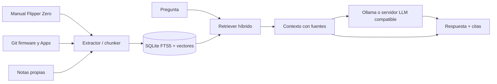

# ◈ Flipper Zero RAG

**Asistente técnico local para Flipper Zero, respaldado por documentos oficiales y código fuente con trazabilidad.**

[Manual oficial](https://docs.flipper.net/zero) · [Documentación de desarrollo](https://developer.flipper.net/flipperzero/doxygen/) · [Firmware](https://github.com/flipperdevices/flipperzero-firmware) · [Apps Catalog](https://github.com/flipperdevices/flipper-application-catalog)

**Novedad v0.7 — Firmware Knowledge Graph:** índice por commit Git de funciones, declaraciones, macros, dependencias y llamadas C; catálogo explícito de API exportada a FAP mediante `targets/f7/api_symbols.csv`; comparador de código y API entre releases. [Explorar documentación v0.7](docs/FIRMWARE_GRAPH_V07.md).

> Proyecto independiente, no afiliado a Flipper Devices. No instala nada en el dispositivo ni lo controla: el RAG se ejecuta en tu PC/Mac/servidor. Uso en dispositivos y sistemas propios o autorizados.

## Qué incluye

- **Cobertura ampliada (v0.5)**: 68 páginas web semilla, 6 repositorios oficiales (firmware, catálogo, uFBT, Protobuf, qFlipper, ejemplos FAP) y 3 fuentes comunitarias opt-in. Ingesta real: páginas web seleccionadas y recorrido opcional de enlaces de `docs.flipper.net` y `developer.flipper.net`, repositorio de firmware oficial, catálogo de aplicaciones oficial y archivos locales.
- **Rastreabilidad**: URLs de fuentes originales, categorías, confianza (`official`/`community`/`local`), hashes, commit Git y líneas del código fuente.
- **Búsqueda híbrida**: SQLite FTS5 (léxica/BM25) + embeddings Ollama (similitud coseno), fusionadas mediante Reciprocal Rank Fusion. **USearch HNSW** (ANN persistente opcional), búsqueda exacta de respaldo si la caché no está lista.
- **Reranking local opcional**: CrossEncoder multilingüe sobre una shortlist de resultados; requiere dependencia extra e instalación local del modelo.
- **Consultas por versión del firmware**: sincronización de etiquetas oficiales release y RC como snapshots separados, filtros exactos y advertencias para documentación sin versión.
- **Asistente local**: Ollama o servidor de chat compatible con OpenAI (llama.cpp, LM Studio o vLLM). Los embeddings también pueden usar una API OpenAI-compatible.
- **Interfaz web**: consultas en español, búsqueda documental, fuentes clicables y estadísticas.
- **Mantenimiento**: actualización incremental, recalculado de embeddings, diagnóstico, benchmark Recall@K/MRR, tests CI y Docker Compose.
- **Uso responsable**: no extrae ni distribuye dumps de tarjetas, llaves privadas, señales grabadas u otros secretos. No permite ejecutar comandos desde la interfaz.

**Ampliación v0.2 (2026-11-22):** seis repositorios oficiales y tres comunitarios opcionales en el catálogo: firmware, Apps Catalog, uFBT, protobuf RPC y ejemplos good-faps. Se han añadido auditoría del índice, fuentes y pruebas, e ingesta local de `.proto`, `.fam`, `.js` y `.py`. Consulta [investigación](docs/RESEARCH_2026.md) y [fuentes](docs/SOURCES.md). El proyecto solo documenta, no ejecuta acciones sobre hardware.

**Novedades v0.3 (2026-11-22):** catálogo de 61 semillas de documentación oficial (formatos NFC/RFID/IR/Sub-GHz, módulos JS, hardware, Devboard, Furi y depuración). Filtros aplicados **antes** de recuperar candidatos (fuente/categoría/confianza), reducción de coincidencias genéricas, expansión terminológica ES/EN verificable y registro de sincronizaciones. `ingest --prune` y `sync --prune` son opcionales y están protegidos contra escaneos parciales. PDF local opcional, indexado por página (`pip install -e '.[pdf]'`); sin OCR. Nueva evaluación offline reproducible de 12 preguntas técnicas y un control negativo, integrada en CI. Más información en [iteración v0.3](docs/ITERATION_V03.md).

**Novedades v0.4 (2026-11-22):** caché ANN HNSW persistente de USearch con invalidación por cambios SQLite y recuperación exacta automática; reranker local opcional con CrossEncoder y filtro versionado sobre snapshots oficiales por Git tag, sin inferir compatibilidad de documentación genérica o ramas dev. La integración ANN nativa se prueba en un job específico de CI. Ver [especificación técnica v0.4](docs/ITERATION_V04.md).

**Novedades v0.5 (2026-11-22):** módulo de protocolos verificables con **118 fichas curatoriales** y 9 familias (`nfc`, `lf-rfid`, `sub-ghz`, `infrared`, `ibutton`, `gpio`, `expansion`, `bluetooth`, `usb`), 8 guías originales, **68 páginas semilla** en el catálogo oficial, selector en la web, nuevas rutas API y CLI (`protocols list|validate|index`, `--protocol`). Protocolo presente en código `dev` ≠ capacidad garantizada en una release. Los resúmenes son de confianza **local**, aunque enlazan documentación oficial; los filtros estrictos de firmware siguen excluyendo fichas sin versión. Las 53 entradas Sub-GHz y el soporte de ISO 15693 enlazan un **commit exacto del firmware**: la mera presencia de código en esa revisión no acredita disponibilidad en una versión instalada. [Diseño y fuentes v0.5](docs/PROTOCOLS_V05.md).

**Estado del contenido:** se incluyen 15 guías introductorias y 8 guías especializadas de protocolos redactadas para este proyecto. La documentación ajena no está empaquetada ni preindexada. La ingesta de fuentes oficiales debe ejecutarse explícitamente; al hacerlo se descargarán y crearán los índices locales.

## Inicio rápido A — Windows 11, Linux, Mac (Python)

Requisitos: Python **3.10+**, Git y, para la generación de respuestas y búsqueda vectorial, [Ollama](https://ollama.com/).

```bash
# En la raíz del repositorio
python -m venv .venv
# Linux/macOS:
source .venv/bin/activate
# PowerShell Windows:
# .venv\Scripts\Activate.ps1
python -m pip install -e ".[dev]"

# Primeros documentos locales (no necesita Ollama):
flipper-rag ingest --path knowledge/starter
flipper-rag protocols index  # 118 fichas originales con referencias oficiales
flipper-rag ingest --path knowledge/protocols --source-id guias-protocolos
flipper-rag stats
flipper-rag runs # historial de sincronizaciones
flipper-rag audit # Comprueba que las fuentes y el índice sean coherentes

# Interfaz
uvicorn flipper_rag.api:app --host 127.0.0.1 --port 8000
```

Abre **http://127.0.0.1:8000**. Sin Ollama podrás buscar (modo FTS5); la generación de respuestas requiere un LLM activo.

En otra terminal, tras instalar y abrir Ollama:

```bash
ollama pull nomic-embed-text
ollama pull qwen2.5:7b

# Recalcular los vectores de los documentos existentes
flipper-rag reembed
# Para corpus grandes: pip install -e ".[ann]" y flipper-rag ann build

# Ingesta oficial básica (conexión a Internet)
flipper-rag sync --web
# Recorrer enlaces internos del manual y de Developer Docs (hasta 250 páginas, profundidad 2)
flipper-rag sync --web --crawl --max-pages 250 --depth 2
# Incluye documentación del repositorio oficial
flipper-rag sync --firmware
# Catálogo de apps, herramientas de desarrollo y Protobuf
flipper-rag sync --apps
flipper-rag sync --tools
# Opcional: documentación comunitaria, explícitamente no oficial
flipper-rag sync --community
# Opcional: código fuente C y cabeceras; índice considerablemente mayor
flipper-rag sync --firmware --with-code
```

Para indexar una **versión oficial concreta** sin mezclarla con el código de desarrollo actual, ejecuta `flipper-rag sync --firmware-ref 1.5.1 --with-code`. Comprueba la [lista oficial de versiones](https://update.flipperzero.one/builds/firmware/) antes de elegir otra etiqueta.

Para cubrir más contenido oficial en una pasada: `make sync-full` en Linux/macOS (o ejecuta `flipper-rag sync --all --with-code --crawl --max-pages 350 --depth 2` directamente en Windows).

También puedes llamar a la API:

```bash
curl -s -X POST http://127.0.0.1:8000/api/ask \
  -H 'Content-Type: application/json' \
  -d '{"query":"¿Cómo se compila una aplicación FAP mediante uFBT?","top_k":6}'
```

En Windows PowerShell, sustituye `curl` por `Invoke-RestMethod` si `curl` no es el ejecutable esperado:

```powershell
Invoke-RestMethod -Uri http://127.0.0.1:8000/api/ask -Method Post -ContentType 'application/json' -Body '{"query":"Que es FAP?","top_k":6}'
```

### Uso con llama.cpp / LM Studio

Puedes conservar Ollama para **embeddings** y generar las respuestas con tu servidor OpenAI-compatible. Por ejemplo, con llama.cpp escuchando en `http://127.0.0.1:8080/v1`:

```bash
# Linux/macOS (en la misma terminal que inicia Uvicorn):
export RAG_CHAT_PROVIDER=openai
export RAG_OPENAI_BASE_URL=http://127.0.0.1:8080/v1
export RAG_OPENAI_MODEL=local-model
uvicorn flipper_rag.api:app --host 127.0.0.1 --port 8000
```

En PowerShell usa `$env:RAG_CHAT_PROVIDER='openai'`, etc. La URL del servidor OpenAI-compatible debe ser una instancia confiable. Un modelo **chat** no es automáticamente un modelo **embedding**: configura Ollama (`nomic-embed-text`) o `RAG_EMBED_PROVIDER=openai` con un servidor que exponga `/v1/embeddings`. Ver `.env.example`.

### Si quieres búsqueda sin modelos

```bash
# Linux/macOS
export RAG_EMBED_PROVIDER=none
export RAG_CHAT_PROVIDER=none
flipper-rag ingest --path knowledge/starter
flipper-rag search "¿Qué es un archivo FAP?"
```

El asistente no fabricará una respuesta si no existe un LLM; devolverá enlaces de respaldo.

## Inicio rápido B — Docker Compose

Requisitos: Docker y Docker Compose; conexión a Internet para imágenes y modelos. En la carpeta del proyecto:

```bash
docker compose up -d --build
docker compose exec ollama ollama pull nomic-embed-text
docker compose exec ollama ollama pull qwen2.5:7b
docker compose exec rag flipper-rag ingest --path knowledge/starter
docker compose exec rag flipper-rag sync --web
docker compose exec rag flipper-rag sync --firmware
```

Abre **http://localhost:8000**. El primer arranque y las inferencias en CPU dependen de los recursos disponibles; usa un modelo de menor tamaño si es necesario. Compose publica ambos puertos **solo en loopback**. Si utilizas Ollama nativo en Apple Silicon, suele ser más sencillo usar la opción A para aprovechar aceleración local.

## Búsqueda ANN, reranker y versiones (v0.4)

Las funciones nuevas son opcionales y mantienen el modo anterior sin dependencias adicionales.

```bash
# Vectorizar con Ollama ya configurado
flipper-rag reembed
# HNSW persistente (extra de instalación con wheels Windows/Linux/macOS)
python -m pip install -e ".[ann]"
flipper-rag ann build
flipper-rag ann status
# Si actualizas documentos o embeddings, repite ann build

# No necesitas descargar un modelo CrossEncoder hasta habilitarlo.
python -m pip install -e ".[rerank]"
# Bash:
export RAG_RERANK_PROVIDER=cross-encoder
# PowerShell: $env:RAG_RERANK_PROVIDER='cross-encoder'

flipper-rag search "¿Qué API de NFC se encuentra en Furi?" --rerank
flipper-rag sync --firmware-ref 1.5.1 --with-code
flipper-rag reembed --build-ann
flipper-rag ask "Funciones NFC en 1.5.1" --firmware-version 1.5.1 --version-policy strict --rerank
```

La versión `strict` **solo busca snapshots explícitamente etiquetados**; un manual web actual sin versión queda fuera. La política `include-unversioned` permite mostrar manuales genéricos como «compatibilidad no verificada», nunca como documentación certificada para la versión consultada. El asistente mantiene referencias a revisión Git y un campo visible de compatibilidad. Consulta [arquitectura y limitaciones](docs/ITERATION_V04.md).

## Catálogo especializado de protocolos (v0.5)

```bash
flipper-rag protocols validate
flipper-rag protocols list --family nfc --query iso
flipper-rag protocols list --family sub-ghz --query princeton
flipper-rag protocols index                   # offline, 118 registros
flipper-rag ingest --path knowledge/protocols --source-id guias-protocolos
flipper-rag search "¿En qué se diferencia ISO14443-4A de MIFARE?" --protocol iso-14443-4a --mode lexical
flipper-rag ask "¿Qué significa protocolo NEC?" --protocol nec
flipper-rag eval --file benchmarks/protocols_offline.jsonl --mode lexical
```

La API incluye `GET /api/protocols`, `GET /api/protocols/{id}` y `protocol` opcional en las consultas. El índice de fichas curatoriales no requiere conexión a Internet; las fuentes originales se sincronizan por separado. **El registro cataloga nombres y su procedencia, no constituye un inventario validado de acciones disponibles.** Consulta [el diseño v0.5](docs/PROTOCOLS_V05.md).

## Comandos

| Comando | Función |
|---|---|
| `flipper-rag ingest --path knowledge/starter` | Indexar notas locales |
| `flipper-rag ingest --path /ruta/a/docs --source-id mis-notas` | Añadir documentación propia |
| `flipper-rag ingest --path ./manuales --pdf` | Indexar PDFs locales con capa de texto y referencias `#page=N` (extra `pdf`) |
| `flipper-rag ingest --path ./manuales --source-id manuales --prune` | Eliminar archivos retirados de ese corpus (explícito) |
| `flipper-rag sync --web` | Obtener páginas oficiales seleccionadas |
| `flipper-rag sync --web --crawl --max-pages 250 --depth 2` | Recorrer enlaces internos oficiales (limitado) |
| `flipper-rag sync --firmware` | Clonar y indexar documentación del firmware |
| `flipper-rag sync --apps` | Incluir catálogo oficial de aplicaciones |
| `flipper-rag sync --all` | Manual y 6 repositorios oficiales, sin comunidad |
| `flipper-rag sync --tools` | uFBT, RPC/Protobuf, qFlipper y ejemplos FAP |
| `flipper-rag sync --community` | Opt-in: documentación comunitaria distinta de fuentes oficiales |
| `flipper-rag sync --firmware --with-code` | Incluir cabeceras/C y documentación |
| `flipper-rag sync --all --force` | Reindexar incluso documentos no modificados |
| `flipper-rag sync --firmware --prune` | Quitar entradas Git que ya no están en la selección, solo si el escaneo fue completo |
| `flipper-rag runs --limit 20` | Historial por fuente: documentos, fallos, fecha, estado |
| `flipper-rag reembed` | Completar/reparar embeddings |
| `flipper-rag reembed --build-ann` | Vectorizar y reconstruir índice ANN con USearch |
| `flipper-rag ann build` / `flipper-rag ann status` | Reconstruir o inspeccionar el caché HNSW |
| `flipper-rag sync --firmware-ref 1.5.1 --with-code` | Indexar versión oficial en origen separado de `dev` |
| `flipper-rag search "NFC" --firmware-version 1.5.1 --version-policy strict` | Recuperar solo fuentes etiquetadas para esa release |
| `flipper-rag ask "FAP" --rerank` | Activar reranker local si está instalado y configurado |
| `flipper-rag search "pregunta"` | Inspeccionar fragmentos sin LLM |
| `flipper-rag ask "pregunta"` | Consultar el RAG con citas |
| `flipper-rag stats` | Contar documentos, fragmentos y vectores |
| `flipper-rag sources` | Validar catálogo y mostrar procedencia de fuentes |
| `flipper-rag doctor` | Diagnóstico de dependencias locales |
| `flipper-rag search "FAP" --mode lexical --trust official` | Filtrar por modo y origen |
| `flipper-rag search "GPIO" --category gpio --source-id web-oficial` | Filtrar por categoría y fuente en SQL |
| `flipper-rag search "tarjeta sd" --no-expand` | Desactivar expansión de términos para comparación |
| `flipper-rag eval --file benchmarks/questions.jsonl` | Medir Recall@k y MRR tras ingestar fuentes |
| `flipper-rag eval --file benchmarks/offline.jsonl --mode lexical` | Benchmark offline de recuperación con 15 notas (requiere `--source-id starter` al ingestar) |

**Nota sobre actualizaciones:** se actualizan los documentos modificados y se registra cada ejecución. **No se borra contenido automáticamente.** `--prune` es una operación explícita: en Git solo se aplica cuando la lectura finaliza sin errores y no alcanza el tope de archivos; no borra páginas web, porque el rastreador puede quedarse sin cobertura por red o límites. Si usas `sync --prune` sin `--with-code`, puedes eliminar archivos de código indexados en una ejecución anterior de esa misma fuente. Para reconstruir desde cero, haz una copia de seguridad y elimina `data/flipper_rag.sqlite3` con la aplicación parada.

## Arquitectura



```text
flipperzero-rag/
├── src/flipper_rag/
│   ├── api.py          # FastAPI + HTML
│   ├── web/index.html  # panel
│   ├── cli.py          # comandos
│   ├── sources.py      # web/git/local
│   ├── chunking.py     # fragmentación con líneas
│   ├── storage.py      # SQLite + FTS5 + vectores
│   ├── retrieval.py    # fusión de ranking
│   ├── models.py       # Ollama / API chat compatible
│   └── service.py      # contexto, respuesta y citas
├── sources.json        # 61 semillas web y 9 repos Git permitidos
├── knowledge/starter/  # 15 guías originales para demo offline
├── tests/              # pruebas automáticas
├── benchmarks/         # preguntas para evaluación
├── docs/               # arquitectura, fuentes, seguridad
├── compose.yaml
└── Dockerfile
```

## Diseño, privacidad y limitaciones

- **Local por defecto.** SQLite y el material clonado se almacenan en `data/`, excluido de Git. El proyecto no incluye autenticación: **no publiques Uvicorn en `0.0.0.0` fuera de redes controladas** ni abras los puertos sin autenticación/TLS.
- **Fidelidad de las citas.** Los enlaces Git corresponden a un commit concreto y un rango de líneas. Los documentos web enlazan a la página de origen, pero su contenido puede cambiar con el tiempo. El LLM puede citar mal: revisa los enlaces en tareas críticas.
- **Legal y licencias.** El firmware oficial tiene licencia **GPL-3.0**; el contenido de otras fuentes puede tener licencias distintas. Este repositorio MIT contiene código propio y notas propias; **no redistribuye copias de documentación o código de terceros**. Una base de datos derivada o sus redistribuciones requieren revisión de términos y atribuciones.
- **Rendimiento.** Los filtros de fuente, categoría y confianza se ejecutan en SQL antes del ranking, con términos de búsqueda técnica y expansión ES/EN. Los vectores están guardados como JSON en SQLite y la búsqueda semántica es de fuerza bruta. Adecuado para prototipos/corpus medianos; para cientos de miles de fragmentos conviene pgvector/Qdrant/FAISS. No incorpora reranking neuronal ni OCR/PDF.
- **Fuentes y web.** La extracción HTML es conservadora, valida el dominio, bloquea redirecciones a otros hosts y consulta robots.txt. Puede fallar ante cambios del sitio o contenido renderizado por JS. Comprueba siempre `stats` después de sincronizar.
- **Seguridad.** El prompt delimita el contenido indexado como datos no confiables, pero ningún prompt elimina por completo los riesgos de prompt injection. No uses este servicio para accionar hardware sin validar explícitamente los comandos. Ver `docs/SECURITY.md`.

## Pruebas y control de calidad

```bash
python -m pytest -q
python -m compileall -q src
flipper-rag eval --file benchmarks/questions.jsonl
```

El conjunto de evaluación es intencionadamente pequeño y orientativo: **no garantiza exactitud factual de las respuestas**. El benchmark offline (`benchmarks/offline.jsonl`) usa 12 preguntas positivas y 1 negativa sobre las notas de demostración, mientras el benchmark oficial (`benchmarks/questions.jsonl`) requiere ejecutar la sincronización y se mide separadamente. Se recomienda ampliar las preguntas con versiones de firmware, APIs y tareas reales.

## Licencia

Código propio del RAG: MIT (ver `LICENSE`). Las marcas Flipper, Flipper Zero y los repositorios documentales pertenecen a sus respectivos titulares. No afiliado a Flipper Devices.

## Repositorio y siguientes pasos

Código fuente y contribuciones: [mudanzasalegre/Fipper-Zero-RAG](https://github.com/mudanzasalegre/Fipper-Zero-RAG). La ruta remota mantiene el nombre `Fipper` elegido al crear el repositorio; internamente la aplicación se denomina Flipper Zero RAG.

Documentación complementaria: [Investigación](docs/RESEARCH.md) · [Instalación Windows 11](docs/INSTALL_WINDOWS.md) · [Evaluación](docs/RETRIEVAL_EVAL.md) · [Roadmap](docs/ROADMAP.md).


## v0.6 — Protocol Intelligence (2026-11-22)

**Ontología verificable:** se mantienen los 118 identificadores de v0.5, con 9 familias, 35 perfiles enriquecidos, 27 relaciones documentadas y 4 reglas de clasificación conservadoras. Incluye comparación de capacidades con evidencias, búsqueda por características y contexto físico, navegación del grafo, exportación JSON/JSON-LD, API y panel `/ontology`. La presencia de un símbolo Sub-GHz en `dev` **no** prueba transmisión ni soporte en la release del usuario.

```bash
flipper-rag ontology validate
flipper-rag ontology search --family nfc --feature page-memory
flipper-rag ontology search --capability emulate_data --status limited
flipper-rag ontology show mifare-desfire
flipper-rag ontology compare mifare-classic mifare-desfire
flipper-rag ontology related iso-14443-3a --depth 2
flipper-rag ontology graph --format jsonld
flipper-rag ontology eval --file benchmarks/ontology_v06.jsonl
flipper-rag ontology index
uvicorn flipper_rag.api:app --port 8000  # http://127.0.0.1:8000/ontology
```

**Compatibilidad:** si se indica `--firmware-version`, las capacidades generales sin una evidencia coincidente pasan a estado **unknown** para esa versión, conservando su documentación general por separado. No se validan dispositivos físicos ni cumplimiento de reglas regionales. Para ejemplos de garantías y límites, consulta [la especificación y fuentes v0.6](docs/ONTOLOGY_V06.md).


## Firmware Knowledge Graph v0.7

El índice estructural se construye **localmente**, sin redistribuir el firmware. Para comparar releases hay que disponer de ambos tags en un clon Git oficial:

```bash
git clone --filter=blob:none https://github.com/flipperdevices/flipperzero-firmware.git data/firmware-upstream
cd data/firmware-upstream && git fetch --tags origin && cd ../..
# Consulta tags disponibles antes de sustituir <VERSION_A> y <VERSION_B>.
flipper-rag firmware index --repo data/firmware-upstream --ref <VERSION_A> --index-rag
flipper-rag firmware index --repo data/firmware-upstream --ref <VERSION_B>
flipper-rag firmware snapshots
flipper-rag firmware symbols --ref <VERSION_A> --query furi_thread
flipper-rag firmware exports --ref <VERSION_A>
flipper-rag firmware compare --before <VERSION_A> --after <VERSION_B>
uvicorn flipper_rag.api:app --host 127.0.0.1 --port 8000
```

Abre `http://127.0.0.1:8000/firmware` para explorar símbolos y relaciones. **Advertencia:** las llamadas y referencias C son análisis estático heurístico; la existencia de una función no garantiza su exportación para FAP ni funcionamiento en el dispositivo. Las comparaciones API incompletas se señalan y no se interpretan como ausencia de cambios. Consulta [diseño, seguridad, alcance y limitaciones](docs/FIRMWARE_GRAPH_V07.md).

## v0.8 — Development Assistant (22-11-2026)

Nuevo **[Development Assistant](http://127.0.0.1:8000/development)**: siete plantillas originales (3 C/Furi FAP y 4 scripts mJS), siete guías citadas, generación de proyectos, validación estática y compilación opt-in con uFBT. La comprobación de API puede consultar el grafo de firmware v0.7; las guías no certifican compatibilidad de firmware.

```bash
flipper-rag dev templates
flipper-rag dev guides
flipper-rag dev scaffold --template furi-dialog --appid demo_app --output ./demo_app
flipper-rag dev validate --project ./demo_app
flipper-rag dev build --project ./demo_app             # simulación: no ejecuta
python -m pip install ufbt
flipper-rag dev build --project ./demo_app --execute   # compilación local real
flipper-rag dev index                                 # indexa guías originales en el RAG
uvicorn flipper_rag.api:app --host 127.0.0.1 --port 8000
```

La compilación **solo** está disponible en CLI local con `--execute`. Puede descargar SDK y ejecutar código de build; usa únicamente proyectos de confianza. Nunca ejecuta `launch`, `flash_usb` ni controla hardware. La API web solo consulta y valida. Para compilar realmente los tres FAP de prueba en GitHub, activa manualmente **Actions → Development assistant - real FAP smoke build → Run workflow**. La suite CI ordinaria usa un ejecutable simulado para los tests del runner.

[Especificación técnica v0.8](docs/DEVELOPMENT_ASSISTANT_V08.md) · [uFBT oficial](https://github.com/flipperdevices/flipperzero-ufbt) · [Desarrollo de apps](https://developer.flipper.net/flipperzero/doxygen/applications.html) · [JavaScript SDK](https://developer.flipper.net/flipperzero/doxygen/js_developing_apps_using_js_sdk.html)
